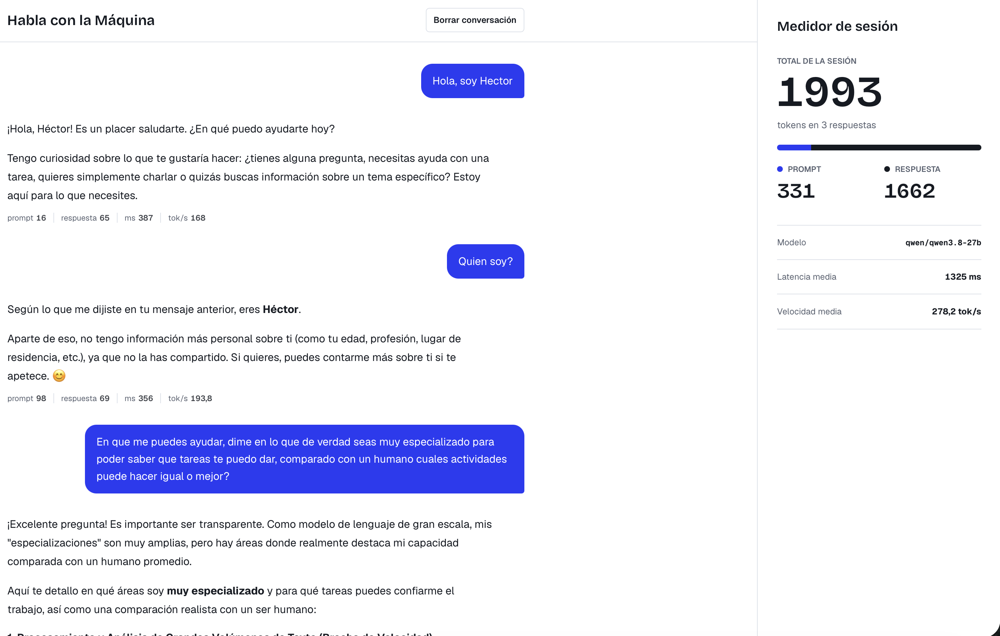
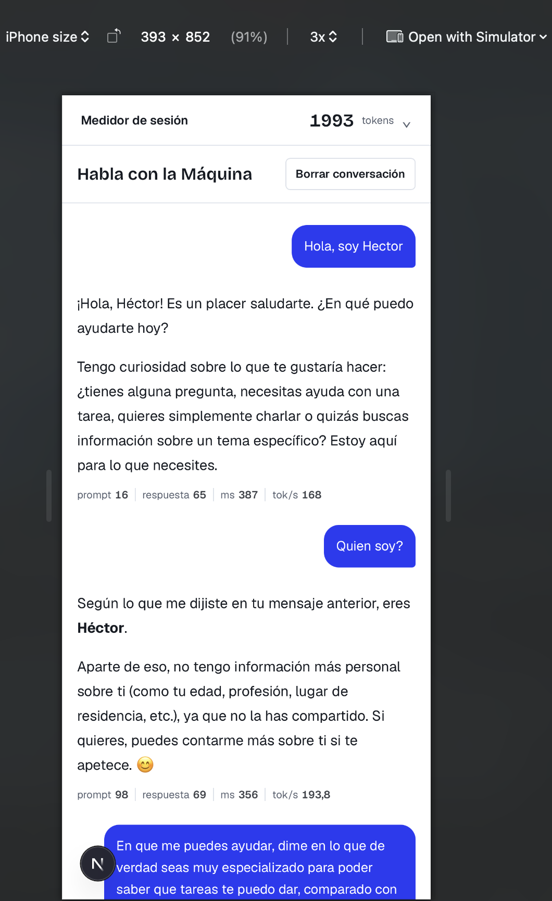
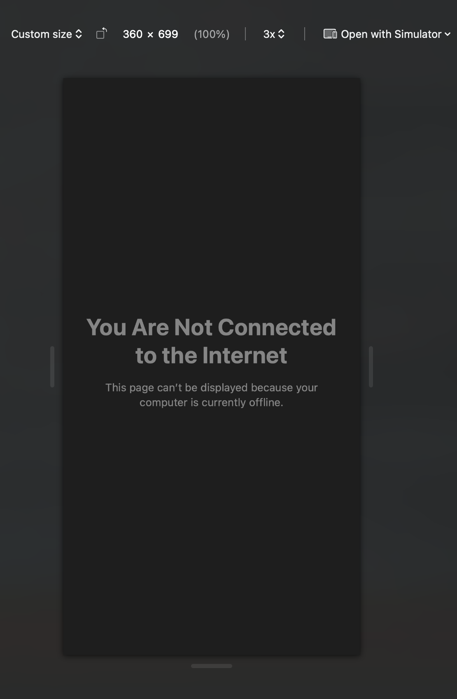
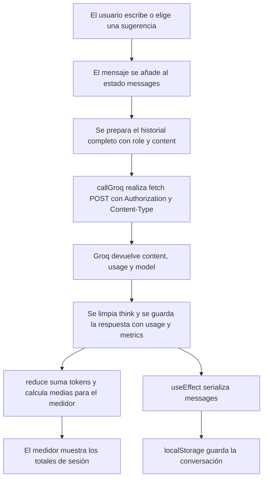

# Habla con la Máquina

Prototipo de chat con Groq para conversar y observar el uso de tokens por respuesta y durante una sesión.

## Capturas

### Escritorio



### Móvil



### Estado de error



## Funcionalidades

- Conversación con Groq mediante la API de chat completions. También se puede iniciar desde las sugerencias del estado vacío.
- Cada petición envía el historial completo disponible, con los campos `role` y `content` de cada mensaje.
- Mientras llega la respuesta, se muestra el estado «Pensando…» y se deshabilitan el campo y el botón de envío.
- Los errores se presentan en español con la opción «Reintentar». Si se recarga después de enviar un mensaje pero antes de recibir respuesta, la interfaz permite reintentarlo sin duplicarlo.
- El medidor acumula tokens de prompt, respuesta y total, y muestra modelo, latencia media, velocidad media y la proporción entre prompt y respuesta.
- Cada respuesta incluye sus métricas de uso, latencia y tokens por segundo.
- La conversación se persiste en `localStorage` y se puede borrar con confirmación en línea.
- Las respuestas de la IA se muestran con Markdown y GFM. El contenido de usuario permanece como texto plano.

## Tecnologías

- Next.js con App Router
- React y TypeScript
- CSS Modules y CSS global
- `react-markdown` y `remark-gfm` para renderizar Markdown
- API de Groq mediante `fetch`; no se usa un SDK

## Requisitos e instalación

- Node.js 20.9 o posterior y npm
- Una API Key de Groq, disponible en [console.groq.com](https://console.groq.com/)

Desde la raíz del proyecto:

```bash
npm install
cp .env.example .env.local
```

En `.env.local`, configura las dos variables que consume la aplicación:

```dotenv
NEXT_PUBLIC_GROQ_API_KEY=tu_clave_de_groq
NEXT_PUBLIC_GROQ_MODEL=qwen/qwen3.8-27b
```

Después inicia el servidor de desarrollo:

```bash
npm run dev
```

`.env.local` está excluido de Git. No imprimas ni subas la clave al repositorio. La variable `NEXT_PUBLIC_GROQ_API_KEY` queda expuesta al navegador, por lo que esta configuración es adecuada solo para el prototipo.

## Cómo funciona



## Medidor de tokens

Los valores se derivan con `reduce` de los mensajes de la IA que contienen `usage` y `metrics`; no se guardan como estado separado. El total de prompt suma `usage.prompt_tokens`, el de respuesta suma `usage.completion_tokens` y el total suma `usage.total_tokens` de cada respuesta.

La latencia media y la velocidad media son promedios por respuesta. La velocidad de cada respuesta se calcula con los tokens de completado y la latencia devuelta por `callGroq`. El modelo mostrado corresponde a la última respuesta. La barra representa la proporción prompt/respuesta del total de tokens. Al recargar, los mensajes guardados conservan sus métricas y permiten recalcular estos valores.

## Persistencia

La conversación completa se guarda en `localStorage` con la clave `habla-maquina:conversacion`, incluidos `usage` y `metrics` de las respuestas. Al montar, la aplicación valida los mensajes cargados; si el JSON está corrupto o no cumple la forma esperada, elimina la clave.

`hasLoaded` evita mostrar el estado vacío antes de terminar la carga y evita que el primer render guarde una conversación vacía sobre la sesión existente. «Borrar conversación» vacía los mensajes y elimina la clave. El almacenamiento es local al navegador.

## Cumplimiento del brief

| Criterio | Implementación |
| --- | --- |
| Llamadas a Groq con `fetch`, endpoint y cabeceras requeridas | `lib/groq.ts` |
| Enviar el historial completo, solo con `role` y `content` | `app/page.tsx`, `lib/groq.ts` |
| Errores legibles, detalle técnico solo en consola y reintento | `lib/groq.ts`, `app/page.tsx`, `components/ErrorBanner/` |
| Guardar `usage` y `metrics` por respuesta y calcular el medidor | `app/page.tsx`, `components/MeterPanel/` |
| Mensajes de usuario en texto plano y respuestas de IA en Markdown | `components/ChatMessage/`, `components/MarkdownContent/` |
| Markdown GFM sin HTML crudo y enlaces externos seguros | `components/MarkdownContent/MarkdownContent.tsx` |
| Estados de carga/error, sugerencias y borrado con confirmación | `app/page.tsx`, `components/EmptyState/`, `components/ClearConversation/` |
| Persistencia validada y carga sin sobrescribir la sesión | `app/page.tsx` |
| Tokens, tipografías, diseño responsive, foco y movimiento reducido | `app/globals.css`, `app/layout.tsx`, `app/page.module.css`, CSS Modules de `components/` |
| No incluir la clave de API en el repositorio | `.gitignore`, `.env.example` |

## Limitaciones conocidas

- `NEXT_PUBLIC_GROQ_API_KEY` se incluye en código disponible al navegador. Es solo apta para este prototipo; en producción, la llamada a Groq debe pasar por una ruta de servidor que proteja la clave.
- Los tokens de razonamiento que informe el modelo pueden contar como tokens de respuesta.
- La latencia medida incluye el tiempo de red entre el navegador y Groq.
- `localStorage` es específico del navegador y perfil local; no sincroniza sesiones entre dispositivos.

## Decisiones y verificación

- [Decisiones técnicas](docs/decisiones.md)
- [Verificación de la conexión con la API de Groq](docs/verificacion-api.md)

## Proceso de diseño

El diseño de partida se generó con v0 y se adaptó a componentes React y CSS Modules del proyecto, sin conservar Tailwind ni librerías de UI. GitHub Copilot se utilizó como asistente de desarrollo siguiendo las reglas de [`.github/copilot-instructions.md`](.github/copilot-instructions.md).

## Estructura del proyecto

```text
app/
	globals.css                 Tokens y estilos globales
	layout.tsx                  Fuentes y metadata
	page.tsx                    Chat, estados, llamadas y persistencia
	page.module.css             Layout responsive
components/
	ChatMessage/                Mensajes de usuario e IA y métricas
	ClearConversation/          Confirmación para borrar
	Composer/                   Campo y envío de mensajes
	EmptyState/                 Estado vacío y sugerencias
	ErrorBanner/                Errores y reintento
	MarkdownContent/            Renderizado seguro de Markdown y GFM
	MeterPanel/                 Totales y métricas de sesión
lib/
	groq.ts                     Cliente fetch, errores y métricas de respuesta

	decisiones.md               Decisiones técnicas
	verificacion-api.md         Resultado de verificación de Groq
	escritorio.png              Captura de escritorio
	movil.png                   Captura móvil
	error.png                   Captura del estado de error
public/                       Recursos estáticos
```
